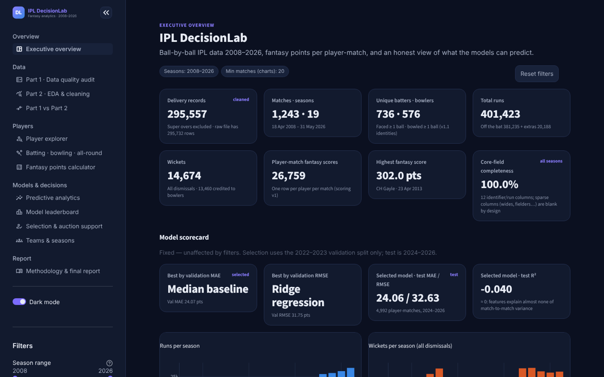
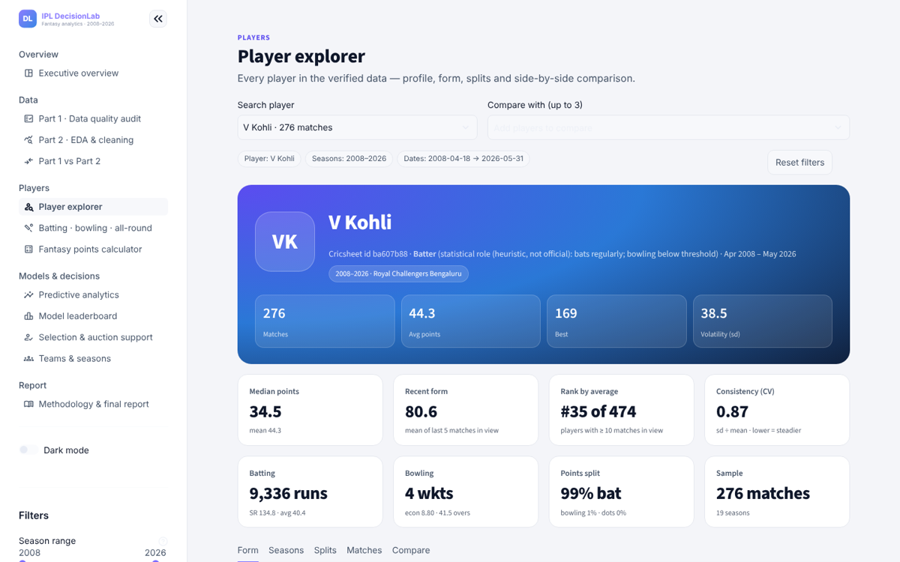
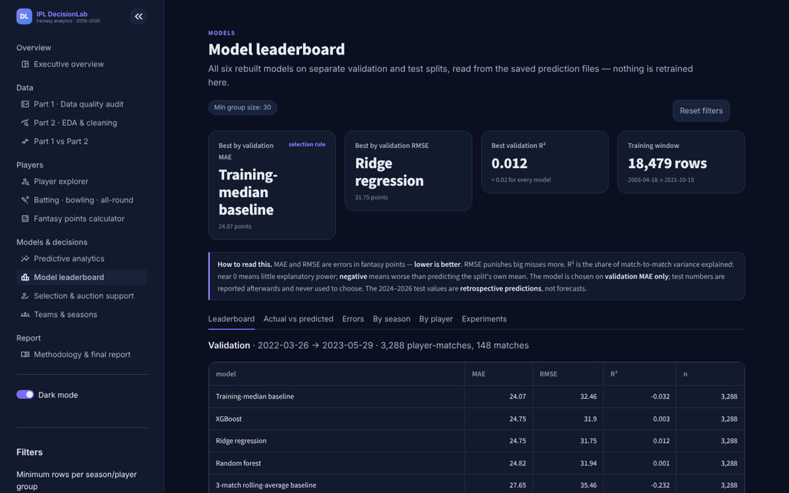
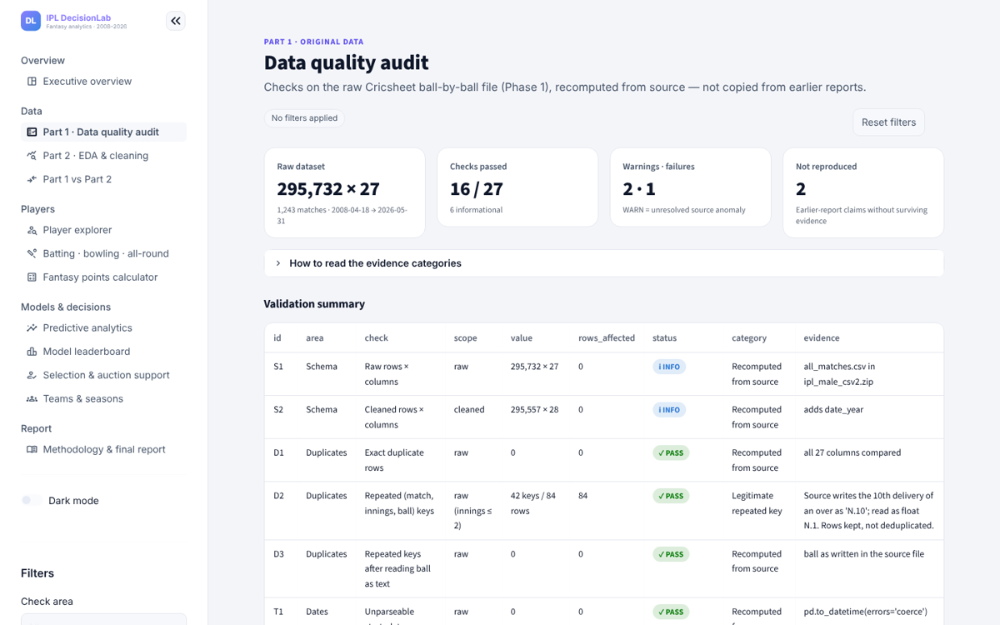
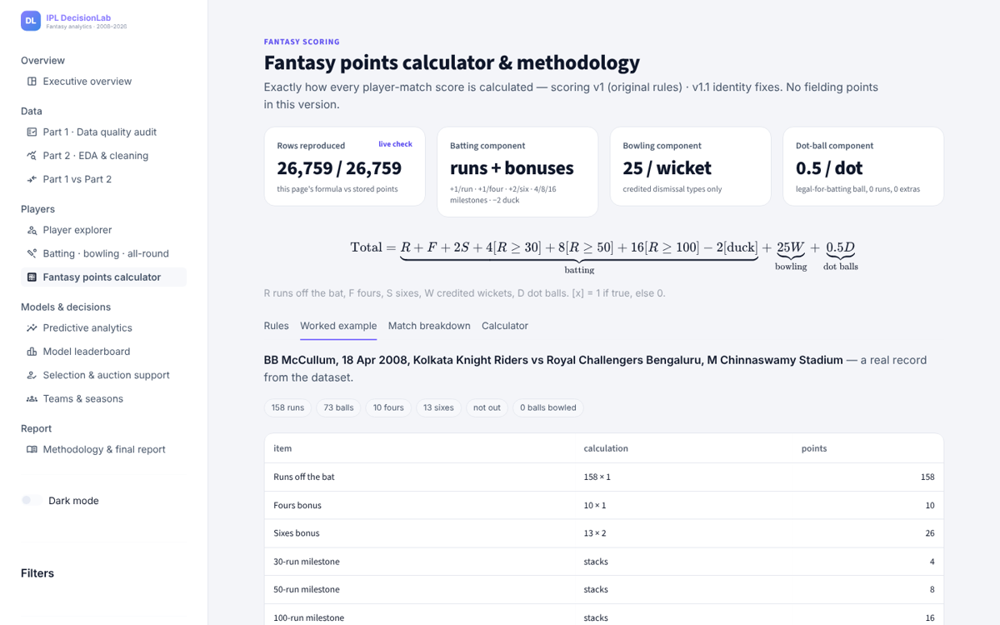
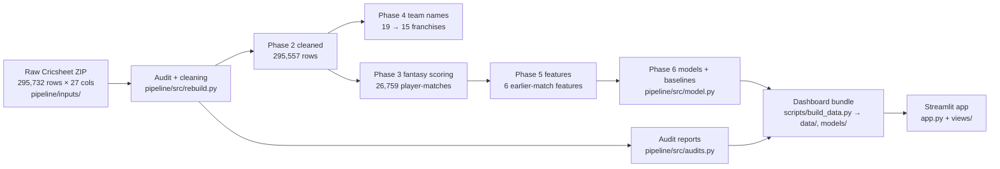

# IPL DecisionLab

**An end-to-end IPL fantasy-analytics platform: audited ball-by-ball data, a verified fantasy-scoring pipeline,
an honest evaluation of whether recent form predicts fantasy points, and a tested 12-page Streamlit dashboard.**

Built on 19 IPL seasons (18 Apr 2008 – 31 May 2026) of Cricsheet data: 295,557 cleaned deliveries, 1,243 matches,
805 players and 26,759 player-match fantasy scores.

> **Headline result — stated up front.** Recent fantasy form barely predicts the next score. On the held-out 2024–2026
> test period the best rebuilt model by the pre-declared rule (validation MAE) is a constant — the training median
> (test MAE 24.06 points) — and no model explains more than 2% of the variance (best test R² 0.017). All predictions
> shown are **retrospective** (made for past matches with information available before each match); the app makes
> **no live forecasts**.

> **Independent project.** Not affiliated with, endorsed by or sponsored by the BCCI, the Indian Premier League, any
> IPL franchise, or Dream11. See [Licence and attribution](#licence-and-attribution).



| | |
| --- | --- |
|  |  |
|  |  |

---

## Contents

[Quick start](#quick-start) · [Pipeline](#data-pipeline) · [Data & cleaning](#data-and-cleaning) ·
[Scoring](#fantasy-scoring) · [Models](#model-evaluation) · [Dashboard](#dashboard-pages) · [Tests](#tests) ·
[Deploy](#deploy-to-streamlit-community-cloud) · [Limitations](#limitations) · [Repository layout](#repository-layout) ·
[Provenance](#project-provenance) · [Licence](#licence-and-attribution)

## Quick start

```bash
git clone <your-repo-url> ipl-decisionlab && cd ipl-decisionlab
python3 -m venv .venv && source .venv/bin/activate      # Python 3.11–3.13 (verified on 3.13)
pip install -r requirements.txt
streamlit run app.py
```

The dashboard reads only `data/` and `models/` (about 6 MB, committed). No secrets, API keys or network access are needed.

## Data pipeline



Reproduce everything from the committed raw snapshot (about 2 minutes):

```bash
pip install -r requirements-dev.txt          # adds matplotlib (pipeline plots) and playwright (browser test)
python3 -I pipeline/src/rebuild.py           # Phase 2, 4, 3, identity v1.1, delivery order, Phase 5
python3 -I pipeline/src/audits.py            # data-quality, repeated-key, identity, discrepancy, provenance reports
python3 -I pipeline/src/model.py             # Phase 6: baselines, Ridge, random forest, XGBoost (fixed seed)
python3 -I pipeline/tests/test_pipeline.py   # 21 checks, incl. byte-identity with the original outputs
python3 -I scripts/build_data.py             # writes the app bundle in data/ and models/
python3 -I scripts/model_experiments.py      # optional offline experiments
```

Running this chain in a fresh clone reproduced every file in `data/` and every model file byte-for-byte or with identical
content (only the build timestamp in `data/manifest.json` changes). Details: [`pipeline/README.md`](pipeline/README.md).

## Data and cleaning

Source: the [Cricsheet](https://cricsheet.org) all-IPL ball-by-ball CSV (ODC-By 1.0). Full file-by-file description:
[`docs/DATA.md`](docs/DATA.md).

**Cleaned ball-by-ball CSV:** [`data/IPL_DecisionLab_Phase2_Cleaned.csv`](data/IPL_DecisionLab_Phase2_Cleaned.csv) —
295,557 deliveries × 28 columns (45.5 MB), 1,243 matches from 18 Apr 2008 to 31 May 2026, sorted by date, match, innings
and ball. Derived from Cricsheet (ODC-By 1.0, see [`NOTICE`](NOTICE)). It is byte-identical to the recovered original and
to `pipeline/src/rebuild.py`'s output (SHA-256 `4aaafe38…fd50b77f`). Team names, season labels and player identities are
standardized in later stages — details and verification steps in
[`docs/DATA.md`](docs/DATA.md#cleaned-ball-by-ball-data-dataipl_decisionlab_phase2_cleanedcsv-committed).

Cleaning removed only 175 rows; everything else was standardizing or documenting. Nothing was imputed.

| Issue | Size | Decision |
| --- | --- | --- |
| Super-over deliveries (innings 3–6) | 175 rows, 16 matches | Removed — tie-breakers, not regulation play; the matches stay |
| Repeated (match, innings, ball) keys | 42 keys, 84 rows | **Kept** — the source writes the 10th delivery of an over as `6.10`, read as float `6.1`; distinct deliveries |
| Franchise renames | 19 names → 15 | Standard name added, original kept |
| Venue name variants | 60 → 38 | Mapped (mapping recovered from the original Phase 2 output; see limitations) |
| Player aliases | 3 merged, 1 kept apart | Decided by Cricsheet registry id, never by similar names |
| Season labels | 2007/08, 2009/10, 2020/21 | Mapped to calendar years 2008, 2010, 2020 |
| Overs with 7 or 0 legal balls | 8 overs | Kept and flagged (likely scorer error in the source) |

The dashboard's audit page reports 27 checks recomputed from the raw file; claims from the earlier, partly lost report that
could not be reproduced are shown as `NOT REPRODUCED`, never as `PASS`.

## Fantasy scoring

A simplified, Dream11-*style* system (v1, **not** official Dream11 rules; no fielding, economy or strike-rate points):

```
total = R + F + 2S + 4·[R≥30] + 8·[R≥50] + 16·[R≥100] − 2·[duck]  +  25·W  +  0.5·D
        └──────────────────── batting ────────────────────────┘   bowling   dot balls
```

R runs off the bat, F fours, S sixes, W credited wickets (caught, bowled, lbw, stumped, caught and bowled, hit wicket),
D dot balls (not a wide, 0 off the bat, 0 extras). Milestones stack; a duck = faced ≥ 1 ball, 0 runs, dismissed in any mode.
Worked example: BB McCullum, 18 Apr 2008 — 158 runs, 10 fours, 13 sixes → 158 + 10 + 26 + 28 = **222**.
`core/scoring.py` is the single implementation; it reproduces all 26,759 stored scores.

## Model evaluation

Target: one player's fantasy points in one match. Features (each from **earlier** matches only): previous points, 3- and
5-match means, 3-match std, trend, matches played. Chronological split: train 2008–2021 (18,479 rows), validation
2022–2023 (3,288), test 2024–2026 (4,992). Selection rule, fixed in advance: lowest validation MAE; test reported once.

| Model | Val MAE | Val RMSE | Val R² | Test MAE | Test RMSE | Test R² |
| --- | --- | --- | --- | --- | --- | --- |
| Training-median baseline (**selected**) | **24.07** | 32.46 | −0.032 | 24.06 | 32.63 | −0.040 |
| Ridge regression (best RMSE) | 24.75 | **31.75** | 0.012 | 24.60 | 31.72 | 0.017 |
| XGBoost | 24.75 | 31.90 | 0.003 | 24.65 | 32.03 | −0.002 |
| Random forest | 24.82 | 31.94 | 0.001 | 24.66 | 31.97 | 0.002 |
| 3-match rolling average | 27.65 | 35.46 | −0.232 | 27.55 | 35.68 | −0.244 |
| Last-match baseline | 32.32 | 43.32 | −0.839 | 32.94 | 44.03 | −0.894 |

Source: `data/phase6_metrics_rebuilt.json`. XGBoost is worse than the median on test MAE by 0.60 points
(95% CI 0.43–0.77, match-level bootstrap).

**Why the median wins on MAE:** MAE is minimised by the median, and fantasy points are right-skewed (test median 28, mean
34); squared-error models aim at the mean. An offline experiment (`scripts/model_experiments.py`, 14 candidates, selected on
validation only) found a HistGradientBoosting model with absolute-error loss and extra history features: test MAE 23.78 vs
24.06 for the median (−0.28, 95% CI −0.41 to −0.15) but RMSE 33.03 vs 32.63 and R² −0.065. Reported separately; the rebuilt
Phase 6 models are unchanged.

## Dashboard pages

| Page | What it shows |
| --- | --- |
| Executive overview | KPIs, season trends, team run-rate heatmap, top performers, consistency, model scorecard |
| Part 1 · Data quality audit | 27 checks recomputed from the raw file, evidence categories, repeated keys, mappings, earlier-report claims |
| Part 2 · EDA & cleaning | Distributions, season/over/venue trends, outliers, cleaning decisions |
| Part 1 vs Part 2 | Before/after metrics with causes, missing values, schema, excluded records, unresolved issues |
| Player explorer | Searchable profiles for all 805 players, statistical role with its reason, form, splits, comparison |
| Batting · bowling · all-round | Role statistics, configurable participation rule, threshold sensitivity, evidence per player |
| Fantasy points calculator | Formula, rules, real worked example, per-match breakdown, calculator, live check of all rows |
| Predictive analytics | Retrospective predictions per player, errors, feature importance, saved-artifact check, limitations |
| Model leaderboard | All 6 models: validation and test metrics, sizes, date ranges, by season, by player, experiments |
| Selection & auction support | Weighted, explained ranking + shortlist; user-uploaded auction prices with validation |
| Teams & seasons | Team batting/bowling by season, contributors by role, venues, name-normalization audit |
| Methodology & final report | Parts 1–6 in plain language, computed from the same data; Markdown/ZIP downloads |

Every page exports its current, filtered view as CSV. A sidebar toggle switches dark/light themes (see
[theme behaviour](#theme-behaviour)).

## Tests

| Suite | Command | What it covers |
| --- | --- | --- |
| Pipeline (21) | `python3 -I pipeline/tests/test_pipeline.py` | Byte-identity with original outputs, super overs, repeated keys, scoring, identity fixes, delivery order, no-look-ahead features, chronological splits, model reproducibility, metric reconciliation |
| App (18) | `python3 tests/test_app.py` | Every page in both themes, KPI reconciliation, filters + reset, scoring on all rows, roles, model artifacts, validation/test separation, CSV exports, missing-data handling |
| Upgrade (17) | `python3 tests/test_upgrade.py` | Auction CSV validation and ID matching, value metrics, no private Streamlit APIs, theme persistence, chart colours, leaderboard reconciliation, experiment protocol, filter isolation |
| Browser (optional) | `streamlit run app.py &` then `python3 tests/browser_check.py` | All 12 pages × 2 themes × 2 widths in Chromium: no errors, no overflow, no element off-theme |

The app suites also run with `python3 -m pytest -q tests` if pytest is installed.

## Deploy to Streamlit Community Cloud

1. Push this repository to GitHub (public, or private with Streamlit access).
2. On <https://share.streamlit.io> → **Create app** → choose the repo and branch, **Main file path `app.py`**.
3. **Advanced settings → Python 3.13** (the pinned `pandas==3.0.5` needs Python ≥ 3.11).
4. No secrets are required. `requirements.txt` is installed automatically; `requirements-dev.txt` is not needed.

`.streamlit/config.toml` (committed) sets the theme base, a 5 MB upload limit and disables usage statistics.

## Limitations

- **Weak predictions.** Form features explain < 2% of variance; typical errors are 20–30 points. Retrospective only — no
  fixtures, playing XIs, injuries or pitch data are modelled.
- **Rebuilt Phase 6.** The original training code was lost; models were retrained with documented, fixed settings.
- **Simplified scoring** (no fielding, economy, strike-rate or haul bonuses); the duck penalty also applies to run-outs and
  retirements, faithful to the original output.
- **Statistical roles.** Cricsheet has no role field; Batter / Bowler / All-rounder / Unknown is a configurable heuristic.
  Wicketkeepers are not inferred.
- **No auction prices.** None exist in the source; the auction tab analyses only prices a user uploads. Price per point
  divides by season total points (players with more matches look cheaper) and prices are not adjusted across seasons.
- **Venue mapping** was recovered from the original output, not re-derived independently.
- **No player photos** (no verified, licensed source); initials are used. No match results, so no wins/losses.
- **Theme toggle** styles Streamlit through public `data-testid`/ARIA hooks; a future Streamlit release could rename them
  (the browser test would catch it).

## Repository layout

```
app.py                     Streamlit entry point (navigation, theme toggle)
views/                     12 dashboard pages
core/                      data loaders, scoring, roles, auction validation, theme tokens
components/ui.py           KPI cards, themed tables, charts, filters, downloads
data/                      dashboard bundle (parquet/CSV/JSON) + cleaned ball-by-ball CSV — see docs/DATA.md
models/                    rebuilt model artifacts + training config
scripts/build_data.py      pipeline outputs → data/ and models/
scripts/model_experiments.py  offline model experiments
pipeline/                  reproducible cleaning, scoring, audit and modelling code, its inputs and tests
templates/                 auction-price CSV template
tests/                     app and upgrade tests, browser check, synthetic auction fixture
docs/                      data dictionary, screenshots
.streamlit/config.toml     theme base, upload limit
```

## Theme behaviour

The sidebar **Dark mode** toggle is stored in the session, so it survives navigation and filter changes. Every visible
element is coloured from one set of tokens (`core/theme.py`); tables are themed HTML (sortable, paginated) because canvas
grids can't follow CSS; each Plotly figure gets explicit per-theme colours. Streamlit's own ⋮ → Settings → Theme changes only
the native base underneath.

## Auction price CSV

No prices ship with the project. Columns: `player`, `registry_id`, `season`, `franchise`, `base_price`, `sold_price`,
`auction_status`, `currency`, `source` (template: `templates/auction_prices_template.csv`). Players match by Cricsheet
registry id, then exact name or known alias — never by similarity. Invalid rows (non-numeric or negative prices, sold without
price, duplicates, missing currency/source) are excluded and reported. `tests/fixtures/auction_synthetic_demo.csv` is
**synthetic test data**; the app shows a "not real prices" banner for such rows.

## Role classification

Bats regularly = batted in ≥ 50% of matches and ≥ 8 balls faced per match; bowls regularly = bowled in ≥ 50% of matches and
≥ 9 legal balls per match. Both → All-rounder; neither, or < 10 matches → Unknown. Thresholds are adjustable in the sidebar.

## Project provenance

Phases 1–6 were first built in Google Colab. That session was lost; the recovered files mixed originals with a flawed
reconstruction. The pipeline in `pipeline/` rebuilds Phases 2–4 from the raw data **byte-identical** to the recovered
originals (SHA-256 match), explains every one of the 19,136 discrepancies in the reconstruction, and retrains Phase 6. The
original Colab notebook code is **not** included — it was not recovered. Recovered intermediate files kept for evidence are
listed in [`docs/DATA.md`](docs/DATA.md). Version history: [`CHANGELOG.md`](CHANGELOG.md).

## Licence and attribution

Data: [Cricsheet](https://cricsheet.org), Open Data Commons Attribution License (ODC-By 1.0) — see [`NOTICE`](NOTICE).
Code licence: *not yet chosen by the author.*

Trademarks and affiliation: IPL DecisionLab is an independent portfolio project. It is not affiliated with, endorsed by
or sponsored by the Board of Control for Cricket in India (BCCI), the Indian Premier League, any IPL franchise, or Dream11.
"IPL", "Indian Premier League", franchise names and "Dream11" are trademarks of their respective owners and are used here
only to describe the data and the style of scoring. Fantasy points are computed with this project's own rules and are not
official Dream11 or IPL figures.
